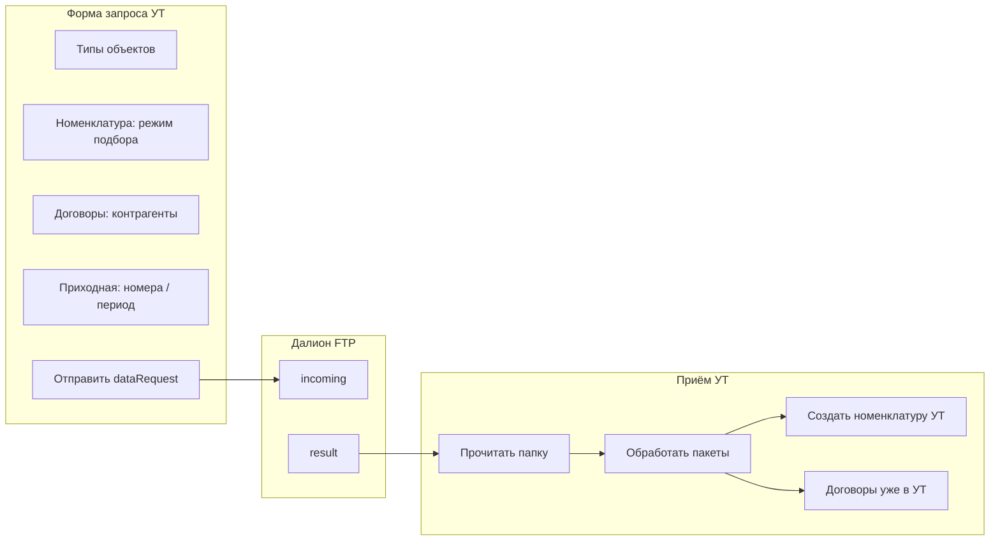

# План: выборочный «Запрос данных Далион» в УТ (ИсходныйПроект)

**Цель:** из обработки «Запрос данных Далион» отправлять в Далион не «всё подряд», а точечные запросы (номенклатура, контрагенты, договоры, приходные), с формами подбора. После приёма ответов — доводить данные до **справочника Номенклатура** и **Договоры контрагентов** УТ.

**База:** `C:\Users\azhel\Desktop\ИсходныйПроект` (расширение ЭАрМ на УТ 11.5).

---

## 1. Что уже есть (не дублировать)

| Узел | Назначение |
|------|------------|
| `DataProcessors/ЭАрМ_ЗапросДанныхДалион` | Флажки типов + период + «Запросить» / «Прочитать папку» |
| `CommonModules/ЭАрМ_ЗапросыДалион` | `ОтправитьЗапросДанных`, `ЗапроситьПриходнуюПоНомеру`; в JSON уже есть `barcodes`, `numbers`, `inn`, `dateFrom`/`dateTo`, `periodDays` |
| `CommonModules/ЭАрМ_ПриемПакетовДалион` | Приём `dalion_*.json` → регистр `ЭАрМ_ПакетыДалион`; обработка: `Номенклатура` → `ЭАрМ_СверкаТоваровЦепочки.ЗагрузитьНоменклатуруДалион`, `ДоговорКонтрагента` → `ЗагрузитьДоговорыВУТ`, `Контрагент` → `ЗагрузитьКонтрагентовВУТ` |
| `CommonModules/ЭАрМ_СверкаТоваровЦепочки` | «Без пары»: регистр `ЭАрМ_СверкаТоваровЦепочки`, ресурс `Штрихкод`, результат `НетВУПД` / `НетВПоступлении`; функция `СтрокБезПары` |
| `CommonModules/ЭАрМ_КатегорииТоваров` | `СоздатьНоменклатуруСВидами` / `СоздатьНедостающуюНоменклатуру` — запись в **Справочник.Номенклатура** |
| Регистры | `ЭАрМ_ШтрихкодыПоставщиков`, `ЭАрМ_ПакетыДалион` (тип `НоменклатураДалион` — карточки JSON), `ЭАрМ_ЗапросыДалион` — статусы запросов |

**Разрыв:** форма запроса не собирает выборочные параметры; после приёма номенклатура попадает в регистры/штрихкоды, а не автоматически в справочник Номенклатура; договоры уже пишутся в УТ, но без отбора «по контрагенту» в UI.

---

## 2. Целевой сценарий пользователя



1. Пользователь открывает **расширенную** форму запроса (или мастер из текущей `ЭАрМ_ЗапросДанныхДалион`).
2. Отмечает нужные типы и **уточняет отбор** (см. §3).
3. УТ кладёт `dalion_dataRequest_<uuid>.json` в incoming (как сейчас).
4. В Далионе выполняется обработка запроса (внешняя обработка / расширение) — ответы в result с тем же `header.requestId`.
5. «Прочитать папку» → регламент → обработка пакетов.
6. По кнопке **«Создать номенклатуру из ответа»** (или авто-опция) — вызов существующего контура `ЭАрМ_КатегорииТоваров` по карточкам с `requestId`.

---

## 3. UI: формы и режимы подбора

### 3.1. Доработать `ЭАрМ_ЗапросДанныхДалион` (основная форма)

Добавить группы (страницы или сворачиваемые блоки):

| Блок | Элементы |
|------|----------|
| **Номенклатура** | Режим: `Вся` / `Только без пары` / `Выбор из регистров` / `Штрихкоды вручную` |
| | Кнопка «Заполнить список» → открывает форму подбора (§3.2) |
| | Таблица `ШтрихкодыЗапроса` (редактируемая) |
| **Договоры** | `Все договоры` / `По контрагентам` — таблица контрагентов УТ (ИНН для JSON) |
| **Приходная** | Режим: `Период` (как сейчас) / `По номерам` — таблица номеров + опционально ИНН поставщика + дата УПД для окна поиска |
| **Контрагенты** | Оставить флажок; опционально — только ИНН из выбранных контрагентов (если позже Далион фильтрует) |

Команды:

- **«Запросить выборочно»** — собирает `objects` + `ПараметрыЗапроса`, вызывает `ЭАрМ_ЗапросыДалион.ОтправитьЗапросДанных`.
- **«Создать номенклатуру по последнему запросу»** — после приёма (§4.3).

### 3.2. Новая форма `ЭАрМ_ПодборНоменклатурыДляЗапроса`

Вариант реализации: **общая форма** (не обязательно отдельная обработка), вызываемая с параметрами.

**Вкладка «Без пары»**

- Отбор: период цепочек / конкретная УПД (из `ЭАрМ_УПД_Входящий` или текущей строки цепочки на главной форме).
- Запрос к `РегистрСведений.ЭАрМ_СверкаТоваровЦепочки`:

```bsl
// Псевдокод отбора
ГДЕ Сверка.Результат В ("НетВУПД", "НетВПоступлении")
  И Сверка.Штрихкод <> ""
  [И период / ИдентификаторУПД через join с цепочкой]
```

- В таблицу формы: штрихкод, наименование из УПД/поступления, контрагент, УПД, отметка.

**Вкладка «Из регистров»**

- Источник 1: `ЭАрМ_ШтрихкодыПоставщиков` — где нет ссылки на `Справочник.Номенклатура` (или пустая номенклатура УТ).
- Источник 2: `ЭАрМ_ПакетыДалион` где `ТипОбъекта = "НоменклатураДалион"` — полный JSON карточки, колонки uid / code / name / barcodes из разбора.
- Источник 3 (опционально): строки `ЭАрМ_УПД_Строки` без сопоставленной номенклатуры.

- Множественный выбор → в массив `barcodes` (и при необходимости сохранить `uid` в комментарий запроса для трассировки).

**Итог формы:** массив штрихкодов (+ опционально структура «метаданные») возвращается на главную форму запроса.

### 3.3. Форма «Договоры по контрагентам»

- Таблица: `Справочник.Контрагенты` (мультивыбор) или партнёр-поставщик из цепочки.
- В запрос уходит:
  - минимум: только тип `ДоговорКонтрагента` (Далион отдаёт все договоры — как сейчас);
  - целевой вариант: новое поле JSON, например `counterpartyInns: ["..."]` + доработка Далиона (§5).

### 3.4. Форма «Приходная по номеру»

- Поля: номер (из УПД / вручную), ИНН, дата документа.
- Сборка параметров как в `ЗапроситьПриходнуюПоНомеру`: `numbers`, `inn`, `dateFrom`/`dateTo`.
- Можно вызывать существующую функцию напрямую для одного номера или объединять несколько номеров в один `dataRequest`.

---

## 4. Серверная логика УТ

### 4.1. Новый общий модуль (рекомендуется)

`ЭАрМ_ЗапросДанныхДалионСервер` (сервер, без привилегий):

| Функция | Назначение |
|---------|------------|
| `ШтрихкодыБезПары(Отбор)` | Пакетный запрос к `ЭАрМ_СверкаТоваровЦепочки` |
| `ШтрихкодыИзРегистров(Источники, Отбор)` | Объединение без дублей |
| `СобратьПараметрыЗапроса(ПараметрыФормы)` | → структура для `ДополнитьДанныеЗапроса` |
| `ОтправитьВыборочныйЗапрос(ПараметрыФормы)` | objects + barcodes/numbers/inn |
| `НоменклатураДляСозданияПоЗапросу(ИдентификаторЗапроса)` | Карточки из `ЭАрМ_ПакетыДалион` + штрихкоды, связанные с requestId |

**Связь requestId с пакетами:** при приёме в `ЭАрМ_ПриемПакетовДалион` уже есть `header.requestId` — убедиться, что в `ЭАрМ_ПакетыДалион` или `ЭАрМ_ЗапросыДалион` можно отфильтровать пакеты по `ИдентификаторЗапроса` (при необходимости добавить реквизит в регистр пакетов или хранить в `ДанныеПакета.header`).

### 4.2. Расширить `ЭАрМ_ЗапросыДалион.ДополнитьДанныеЗапроса`

- `counterpartyInns` — массив строк (если согласовано с Далионом).
- `nomenclatureUids` — опционально, если Далион научится отдавать карточки по uid без полного справочника.
- Расширить `ОписаниеСоставаЗапроса` для журнала/регистра запросов.

### 4.3. Запись в справочник **Номенклатура** после приёма

Цепочка **не менять**, а **стыковать**:

1. `ЗагрузитьНоменклатуруДалион` — как сейчас (штрихкоды + `СохранитьКарточкуНоменклатурыДалиon`).
2. Новая команда на форме запроса:
   - `ЭАрМ_КатегорииТоваров.ТоварыИзКарточекДалион(ИдентификаторЗапроса)` — обёртка: читает JSON из `ЭАрМ_ПакетыДалион`, формирует массив `{Наименование, Штрихкод, Категория}`.
   - Открыть существующее окно выбора **видов номенклатуры** (как в обработке категорий) → `СоздатьНоменклатуруСВидами`.
3. Опционально: флажок «После приёма автоматически предложить создание номенклатуры», если в ответе был тип `Номенклатура`.

**Договоры:** менять не нужно — `ЗагрузитьДоговорыВУТ` уже пишет в `Справочники.ДоговорыКонтрагентов` по метке `DALION:uid`. В UI — только отбор запроса по контрагентам (§5).

---

## 5. Доработки на стороне Далиона (согласование контракта JSON)

Внешняя обработка `ВыгрузкаДанныхДалион` (каталог ОбменБух) — частично сделано:

| Поле запроса | Далион сегодня | Нужно |
|--------------|----------------|--------|
| `barcodes[]` | Номенклатура по штрихкодам | OK |
| `numbers[]`, `inn`, `dateFrom`/`dateTo` | Приходная | Доработать фильтр по номерам в обработке (если ещё нет) |
| `objects` без номенклатуры | Договоры все | OK |
| `counterpartyInns[]` | — | Фильтр `ДоговорыНаFTP` по `Владелец.ИНН` |
| `Контрагент` | — | По желанию: выгрузка контрагентов по ИНН |

---

## 6. Этапы реализации

| Этап | Содержание | Зависимости |
|------|------------|-------------|
| **0** | Зафиксировать контракт JSON (barcodes, numbers, inn, counterpartyInns) в комментарии к `ЭАрМ_ЗапросыДалион` | — |
| **1** | Модуль `ЭАрМ_ЗапросДанныхДалионСервер`: запросы «без пары» + регистры | Регистры ЭАрМ |
| **2** | Форма подбора номенклатуры + таблица штрихкодов на главной форме | Этап 1 |
| **3** | Блок «Приходная по номерам» (переиспользовать `ЗапроситьПриходнуюПоНомеру`) | — |
| **4** | Блок «Договоры по контрагентам» (UI + inn в JSON) | Этап 5 для точного отбора |
| **5** | Далион: `counterpartyInns`, `numbers` для приходных | FTP |
| **6** | Кнопка «Создать номенклатуру из ответа» + связь по `requestId` | `ЭАрМ_КатегорииТоваров` |
| **7** | Приём пакетов: при необходимости сохранять `requestId` в регистре для фильтра | ЭАрМ_ПакетыДалион |

Оценка: **1–2 недели** при последовательной разработке и тесте на одном FTP-контуре.

---

## 7. Проверка (чек-лист)

- [ ] Запрос только `barcodes` (3 шт.) → в result один/несколько `dalion_Номенклатура_*`, статус запроса «Получен» по типу Номенклатура.
- [ ] «Без пары» после сверки УПД → список совпадает со строками `НетВУПД`/`НетВПоступлении`.
- [ ] Подбор из `ЭАрМ_ШтрихкодыПоставщиков` не дублирует штрихкоды в JSON.
- [ ] `numbers` + `inn` → одна приходная в result, цепочка обновилась.
- [ ] Договоры: после приёма запись в `ДоговорыКонтрагентов`, повторный приём идempotent по `DALION:uid`.
- [ ] «Создать номенклатуру» → элементы в `Справочник.Номенклатура`, штрихкоды связаны.
- [ ] Пустой ответ по номенклатуре (count=0) → статус запроса не «висит» в Отправлен (уже заложено в расширении Далиона).

---

## 8. Файлы конфигурации (ориентир для разработчика)

- `DataProcessors/ЭАрМ_ЗапросДанныхДалион/Forms/Форма/*` — главная форма
- `CommonModules/ЭАрМ_ЗапросыДалион/Ext/Module.bsl` — transport + JSON
- `CommonModules/ЭАрМ_ПриемПакетовДалион/Ext/Module.bsl` — маршрутизация типов
- `CommonModules/ЭАрМ_СверкаТоваровЦепочки/Ext/Module.bsl` — без пары, загрузка номенклатуры
- `CommonModules/ЭАрМ_КатегорииТоваров/Ext/Module.bsl` — создание номенклатуры УТ
- `InformationRegisters/ЭАрМ_СверкаТоваровЦепочки`, `ЭАрМ_ШтрихкодыПоставщиков`, `ЭАрМ_ПакетыДалиon`, `ЭАрМ_ЗапросыДалиon`

Далион: `ОбменБух12_10_2026/ВыгрузкаДанныхДалион` — `ОбработатьЗапросыВыгрузки`.

---

*Документ: план работ. Реализация — следующий шаг по этапам §6.*
